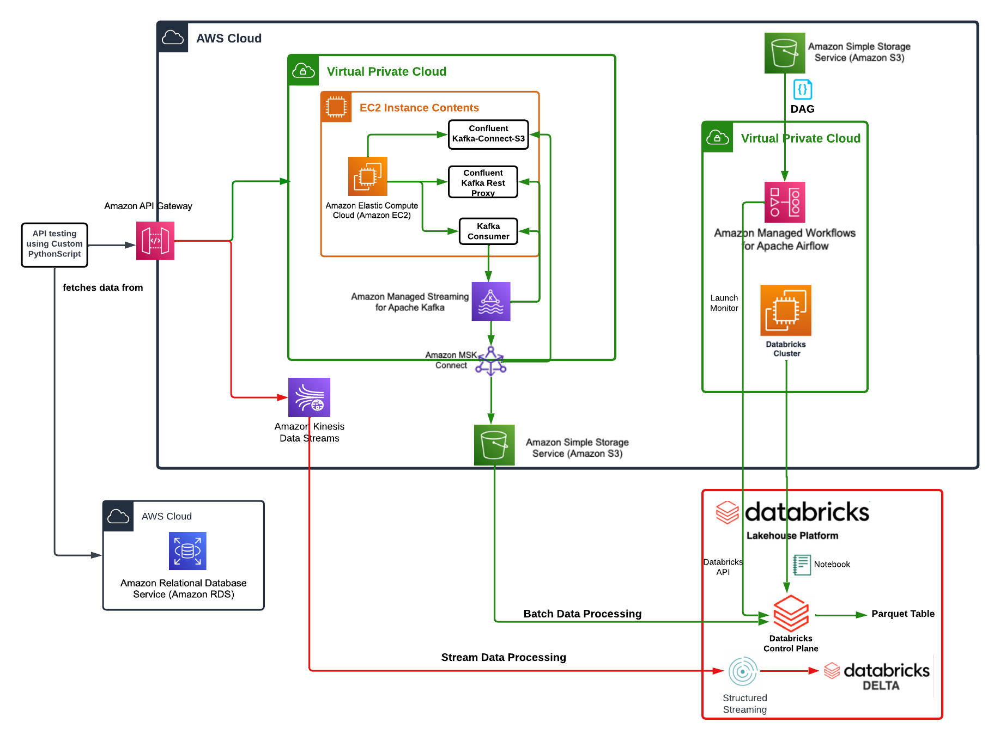

# Pinterest Data Pipeline Project

## Table of Contents
1. [Overview](#overview)
2. [Architecture](#architecture)
3. [Features](#features)
4. [Getting Started](#getting-started)
    - [Prerequisites](#prerequisites)
    - [Installation](#installation)
5. [Usage](#usage)
    - [Batch Processing](#batch-processing)
    - [Stream Processing](#stream-processing)
    - [Data Exploration](#data-exploration)
6. [Future Improvements And Features](#future-improvements-and-features)
7. [Queries](#queries)
8. [License](#license)

## Overview

An end-to-end data engineering pipeline built on AWS, inspired by Pinterest's infrastructure. The pipeline implements a Lambda architecture to handle both batch and real-time stream processing of simulated user post data across three data entities — posts, geolocation, and user data.

## Related Projects

- **This repo (AWS / managed services version):** [pinterest-data-pipeline684](https://github.com/ASEIcode/pinterest-data-pipeline684)
- **Containerised open-source rebuild (in progress):** [pinterest-pipeline-docker](https://github.com/ASEIcode/pinterest-pipeline-docker) — replaces AWS managed services with Docker, Kafka (KRaft), FastAPI, and self-hosted Airflow

## Architecture



---

### Video Walkthrough

[](https://www.loom.com/share/5cc6f009657b4156af9feb7fb5860615)

---

**Directory structure:**

    pinterest-data-pipeline684/
    │
    ├── batch_notebooks/
    │   ├── data_exploration_notebooks/
    │   │   ├── data_exploration_geo.ipynb
    │   │   ├── data_exploration_pin.ipynb
    │   │   └── data_exploration_user.ipynb
    │   ├── create_dataframes_from_s3.ipynb
    │   ├── data_cleaning.ipynb
    │   ├── mount_s3_to_databricks.ipynb
    │   └── 0e95b18877fd_dag.py
    │
    ├── stream_notebooks/
    │   ├── data_cleaning_stream.ipynb
    │   └── read_stream.ipynb
    │
    ├── user_post_emulators/
    │   ├── user_posting_emulation.py
    │   └── user_posting_emulation_streaming.py
    │
    ├── .github/
    │   └── workflows/
    │       └── lint.yml
    │
    ├── .gitignore
    ├── Queries.ipynb
    ├── README.md
    └── requirements.txt

### Batch processing path

1. **Data Generation with User Posting Emulator:** The user posting emulator simulates user activities — posts, comments, likes — generating synthetic data across three entities: Pinterest posts, geolocation, and user data.

2. **Data Ingestion via API Gateway:** Data is sent to AWS API Gateway, which routes incoming requests into the AWS ecosystem.

3. **Data Routing to EC2 Instance:** Data passes to an EC2 instance running the Confluent Kafka REST proxy, which publishes messages to Kafka topics.

4. **Streaming Data with Kafka and MSK:** Data is published to Apache Kafka topics within Amazon MSK (Managed Streaming for Apache Kafka).

5. **Confluent Connect and S3 Sink:** A Kafka Connect S3 Sink connector moves data from Kafka topics into an S3 bucket for durable storage.

6. **Kafka Consumers with MSK Connect:** Kafka consumers process the streaming data and move it into Databricks for deeper analysis.

7. **Data Processing in Databricks:** Using Apache Spark, data undergoes cleaning, transformation, and aggregation through a bronze/silver/gold medallion architecture.

8. **Workflow Orchestration with Apache Airflow:** Apache Airflow (MWAA) orchestrates the batch pipeline, scheduling daily runs of the data cleaning and transformation notebooks.

### Real-Time Data Streaming Path

1. **Real-Time Data Generation:** The streaming emulator generates real-time events and sends them directly to AWS Kinesis Data Streams.

2. **Data Ingestion via AWS Kinesis:** Three Kinesis streams (pin, geo, user) capture data in real-time.

3. **Processing with Databricks and Spark Structured Streaming:** Data from Kinesis is processed using Spark Structured Streaming, with results written to Delta Lake tables.

4. **Workflow Orchestration with Apache Airflow:** A nightly Airflow DAG merges the previous day's streaming Delta tables with the accurate batch silver/gold tables, combining real-time currency with historical accuracy.

5. **Real-Time Analytics:** Processed data is available for dashboards and analytics almost immediately via Databricks notebooks.

## Features

- **Data Ingestion and Storage**
  - Utilizes **AWS S3** for secure, scalable storage of batch data.
  - Integrates **AWS API Gateway** and **Kafka** (via AWS MSK) for efficient real-time data streaming.

- **Data Processing**
  - Leverages **Databricks** for advanced data analytics, employing **Apache Spark** for both batch and stream processing.
  - Implements **Lambda architecture** for handling vast datasets with a balance of speed and accuracy.

- **Workflow Orchestration**
  - Uses **Apache Airflow** (AWS MWAA) for orchestrating and automating the data pipeline workflows, ensuring timely execution of data processing tasks.

- **Real-Time Data Streaming**
  - Incorporates **AWS Kinesis** for real-time data collection and analysis, enabling immediate insights and responses.

- **Data Cleaning and Transformation**
  - Applies comprehensive data cleaning techniques in **Databricks notebooks** to ensure data quality and reliability for analysis.
  - Employs custom **Python** scripts and **Spark SQL** for data transformation and preparation.

- **Analytics and Reporting**
  - Facilitates advanced data analytics within Databricks, using both **PySpark** and **Spark SQL** for deep dives into the data.

- **CI/CD**
  - GitHub Actions workflow running flake8 linting on every push, scoped to `user_post_emulators/`.

- **Security and Compliance**
  - Adheres to best practices in cloud security, leveraging AWS's robust security features to protect data integrity and privacy.

- **Scalability and Performance**
  - Designed for scalability, easily handling increases in data volume without compromising on processing time or resource efficiency.

## Getting Started

### Prerequisites

- **AWS Cloud Account**: [Sign up here](https://aws.amazon.com/)
- **Databricks Workspace**: [Start a free trial](https://databricks.com/try-databricks)
- **Python 3.x**: [Download Python](https://www.python.org/downloads/)
- **Required Python Libraries**: Listed in `requirements.txt`
- **Git**: [Install Git](https://git-scm.com/downloads)
- **IDE/Code Editor**: VSCode recommended

**Additional Setup:**
- **Configure AWS CLI**: [AWS CLI configuration guide](https://docs.aws.amazon.com/cli/latest/userguide/cli-configure-quickstart.html)
- **Set Up SSH Key for GitHub**: [GitHub SSH key setup guide](https://docs.github.com/en/authentication/connecting-to-github-with-ssh)

### Installation

1. **Clone the Repository**

```bash
git clone git@github.com:ASEIcode/pinterest-data-pipeline684.git
cd pinterest-data-pipeline684
```

2. **Set Up Your AWS Environment**

    - **Create an S3 bucket**: [Instructions](https://docs.aws.amazon.com/AmazonS3/latest/userguide/create-bucket-overview.html)

    - **Upload Dummy Data to RDS**: [Instructions and dummy data](https://colab.research.google.com/drive/10nomdkaryd95so32EHu4bqzx96lmnmb8?usp=sharing)

    - **Establish an MSK cluster and EC2 client machine**: [Instructions](https://colab.research.google.com/drive/1gYFc5W_TILdgDMprHXgwmjte7pxXp-_vV?usp=sharing)

        Create your three topics (`0e9518877fd.pin`, `0e9518877fd.geo`, `0e9518877fd.user`):

```bash
./kafka-topics.sh --bootstrap-server BootstrapServerString --command-config client.properties --create --topic <topic_name>
```

    - **Create a custom Plugin with MSK Connect**: [Instructions](https://colab.research.google.com/drive/1zDDX7S1X2FxQF6Fnw6mmRmriEnTkYw9_?usp=sharing)

    - **Set up API Gateway**:
      - [Set up REST API](https://colab.research.google.com/drive/1epCnS6ltyPtciuLG4vgWjte7pxXp-_vV?usp=sharing)
      - [Integrate with Kafka](https://colab.research.google.com/drive/1Zb_BaI8Nv-pL2mvr8yE1Y3d-sf4AP5lg?usp=sharing)

        Modify `user_posting_emulation.py`:

        1. Create `db_creds.yaml`:

```
HOST : <RDS HOST NAME>
USER : <YOUR USER NAME>
PASSWORD : <RDS PASSWORD>
DATABASE : <DATABASE NAME>
PORT : 3306
```

        2. Add `db_creds.yaml` to `.gitignore`
        3. Replace invoke URLs for each topic:

```
https://YourAPIInvokeURL/YourDeploymentStage/topics/YourTopicName
```

        4. Verify data is flowing by running a Kafka consumer per topic
        5. Confirm data appears in S3 under `topics/<TOPIC_NAME>/partition=0/`

    - **Configure Kinesis Data Streams**:

        1. Create three streams (pin, geo, user) in the Kinesis console using On-demand capacity mode
        2. [Configure REST API to invoke Kinesis](https://colab.research.google.com/drive/1GnwFW22hNpslDmq6N73fXc7zjqhebXp-?usp=sharing)
        3. Modify `user_posting_emulation_streaming.py` — replace StreamName, Data fields, PartitionKey, and invoke URLs:

```
https://YourAPIInvokeURL/<YourDeploymentStage>/streams/<your_stream_name>/record
```

3. **Configure Databricks Workspace**
    - [Import notebooks](https://docs.databricks.com/en/notebooks/notebook-export-import.html)
    - [Set up a cluster](https://colab.research.google.com/drive/1huJvijXGCqU3-lJCazj37Mdl9jzH_YTR?usp=sharing)
    - Mount your S3 bucket using `mount_s3_to_databricks.ipynb` — update the Delta table path to match your credentials location

4. **Initialise Apache Airflow (MWAA)**
    - [Set up MWAA environment](https://colab.research.google.com/drive/1m4PQq2xbfvOqJ_4xt34aRRRKW1nNsP_P?usp=sharing)
    - [Orchestrate a workload](https://colab.research.google.com/drive/1Zzwkce_sSr51cV5FyhtsCWhhSdj0XlL_?usp=sharing)

## Usage

### Batch Processing

1. SSH into your EC2 instance:

```bash
ssh -i /path/to/your-key.pem ec2-user@your-ec2-public-dns.amazonaws.com
```

2. Start the Confluent REST API:

```bash
./kafka-rest-start /home/ec2-user/confluent-7.2.0/etc/kafka-rest/kafka-rest.properties
```

3. Run the User Posting Emulator:

```bash
python user_posting_emulation.py
```

This runs continuously until interrupted.

4. Data flows through API Gateway → EC2 → Kafka/MSK → S3.

5. Use `data_cleaning.ipynb` in Databricks to clean and transform the data.

6. Use the provided Airflow DAG to schedule daily runs of the cleaning notebook.

### Stream Processing

1. Run the streaming emulator:

```bash
python user_posting_emulation_streaming.py
```

2. Data flows into the three Kinesis streams (pin, geo, user).

3. Run `data_cleaning_stream.ipynb` in Databricks to read, clean, and write each stream to a Delta table in real-time.

4. A nightly Airflow DAG merges the streaming Delta tables with the batch silver/gold tables.

### Data Exploration

The `data_exploration_notebooks/` folder inside `batch_notebooks/` contains notebooks documenting the profiling and transformation decisions made for each data entity. Each notebook ends with the final cleaning code that feeds into `data_cleaning.ipynb`.

## Queries

`Queries.ipynb` contains Spark SQL queries demonstrating insights available from the data:

- **Category popularity** by country and by year
- **Geolocation insights** — user distribution across regions
- **User engagement** — follower counts by age group and join year
- **Temporal trends** — user growth and activity patterns 2015–2020

## Future Improvements And Features

- **Real-time dashboards** — Grafana or Amazon QuickSight integrated with Kinesis streams
- **Advanced analytics** — ML models for trend prediction and sentiment analysis
- **Data quality monitoring** — Soda.io or Great Expectations with automated drift alerts
- **Interactive querying interface** — ad-hoc query tool for non-technical users
- **Full containerised rebuild** — see [pinterest-pipeline-docker](https://github.com/ASEIcode/pinterest-pipeline-docker)

## License

This project is open sourced under the MIT License. Free to use, modify, and share for personal and commercial purposes with appropriate credit to the original author.
